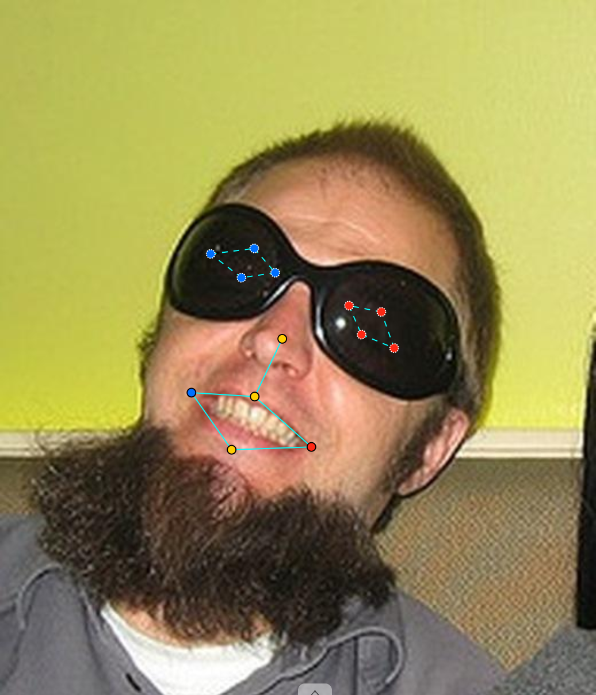

# Báo cáo cá nhân — NguyenThiHongHanh-2A202603272

Dữ liệu: 12 ảnh người COCO 2017 và 8 ảnh khuôn mặt theo bộ ảnh được tạo cho MSSV. Ảnh chỉ dùng trong lớp.

## 0. Thông tin học viên

- Họ tên: Nguyen Thi Hong Hanh
- MSSV: 2A202603272
- Email: 26.
- Link repository: https://github.com/walnut1712/K5-L2B-NguyenThiHongHanh-2A202603272-KeypointPose-Student
- Phiên bản CVAT (Help → About): 2.74.1
- Máy: Windows · RAM 16 · CVAT chế độ: Local
- Bộ ảnh (`src/exports/assignment.json` do `lab.py setup` tạo): Có
- Giờ bắt đầu: 16h00 13/11/2026
- Giờ kết thúc: 19h30 13/11/2026

## 1. Kiểm tra label (CP0)

| Label | Kiểu | Số điểm | Tên điểm đúng bảng của lab? | Đúng thứ tự? | Số cạnh |
|---|---|---:|---|---|---:|
| `person` | Skeleton | 17 | Có (checker không báo sai tên) | Có (checker không báo sai thứ tự) | 19 |
| `face` | Skeleton | 13 | Có (checker không báo sai tên) | Có (checker không báo sai thứ tự) | 13 |

Mẫu `person` dựng theo người quay mặt về camera (các điểm `left_*` nằm bên phải khung mẫu)? **[Xác nhận Có/Không trong CVAT]**
- Có (theo quy ước trái/phải của mẫu; cần đối chiếu lại label constructor trên CVAT trước khi nộp).

Cách đổi cờ `occluded` / `outside` cho **một điểm** trên phiên bản CVAT này (một câu):
- Chọn skeleton, chọn đúng keypoint trên canvas hoặc trong danh sách Skeleton parts ở Objects Sidebar, sau đó bật thuộc tính Occluded hoặc Outside trong phần Properties của chính điểm đó.

**[Mô tả thao tác đúng với phiên bản CVAT bạn đã dùng.]**

## 2. Số lượng đã gán và thời gian (CP1, CP2)

| Nhóm ảnh | Số ảnh | Số skeleton đã gán | Số người dưới 60 px (không gán) | Số poster / gương / màn hình bỏ qua | Thời gian (phút) |
|---|---:|---:|---:|---:|---:|
| `easy` | 5 | 5 | 12 | 0 | Không ghi nhận riêng |
| `occluded` | 3 | 6 | 0 | 0 | Không ghi nhận riêng |
| `back` | 2 | 3 | 4 | 0 | Không ghi nhận riêng |
| `small` | 1 | 1 | 0 | 0 | Không ghi nhận riêng |
| `crowd` | 1 | 3 | 0 | 0 | Không ghi nhận riêng |
| `faces` | 8 | 8 | — | Không ghi nhận | Không ghi nhận riêng |
| **Tổng ảnh người** | **12** | **18** | **16** | **0** | — |

- Số ảnh người đã xong ở mốc phút 105: **10 / 10**
- Thời gian thực tế: **210 phút (16:00–19:30)**.
- CP1: **Không ghi nhận riêng** · CP2: **Không ghi nhận riêng** · CP3: **Không ghi nhận riêng**.
- Ảnh tốn thời gian nhất là `1_label_person.jpg`, vì người trong ảnh đang thực hiện tư thế vận động phức tạp: một tay giơ cao cầm đĩa, thân người nghiêng và hai chân dang chéo. Việc xác định chính xác vị trí các khớp, đặc biệt là khớp vai, khuỷu tay, cổ tay và hông, mất nhiều thời gian hơn so với các tư thế đứng thông thường.

## 3. Bảng ca khó (CP1, CP2)

Tự ghi các trường hợp bạn thực sự phân vân khi gán; không điền ví dụ không xảy ra trong job của bạn.

| Ảnh | Người / mặt | Điểm | Cờ đã chọn | Phân vân giữa | Lý do chọn |
|---|---|---|---:|---|---|
| | | | | | |
| | | | | | |
| | | | | | |

## 4. Bảng tự review (CP3)

Tự review 5 ảnh người (ít nhất 2 ảnh `back` hoặc `crowd`) và 3 ảnh mặt, ghi lỗi trước khi sửa. Dùng mã `lr_swap`, `vis_flag`, `position`, `missing`, `extra`, hoặc `ok`.

| Ảnh | Người / mặt | Điểm | Mã lỗi | Ghi chú | Đã sửa? |
|---|---|---|---|---|---|
| | | | | | |
| | | | | | |
| | | | | | |
| | | | | | |
| | | | | | |
| | | | | | |
| | | | | | |
| | | | | | |

Tổng hợp số lỗi theo mã:

| `lr_swap` | `vis_flag` | `position` | `missing` | `extra` | `ok` |
|---:|---:|---:|---:|---:|---:|
| | | | | | |

Điểm còn phân vân giữa `v = 1` và `v = 0` (ghi cả hai lựa chọn và lý do chọn): **[Tự ghi theo job thật.]**

## 5. Kiểm file xuất và kết quả tự kiểm (CP4)

Kết quả kiểm cấu trúc cho biết mỗi annotation người có 51 số, mỗi annotation mặt có 39 số. Tự mở file JSON và đối chiếu thủ công các điểm cùng cờ trước khi đánh dấu các dòng bên dưới là đạt.

| File | Người / mặt kiểm (ảnh, thứ tự) | Số phần tử `keypoints` | Điểm `outside` ra `v = 0`, `occluded` ra `v = 1`? | `num_keypoints` khớp? |
|---|---|---:|---|---|
| `NguyenThiHongHanh_persons.zip` | **[Tự kiểm và ghi ảnh/thứ tự]** | 51 | **[Tự kiểm]** | **[Tự kiểm]** |
| `NguyenThiHongHanh_persons.zip` | **[Tự kiểm và ghi ảnh/thứ tự]** | 51 | **[Tự kiểm]** | **[Tự kiểm]** |
| `NguyenThiHongHanh_faces.zip` | **[Tự kiểm và ghi ảnh/thứ tự]** | 39 | **[Tự kiểm]** | **[Tự kiểm]** |

Theo quy ước COCO của bài: `occluded` → `v = 1`; `outside` → `v = 0`. Checker ghi nhận các điểm `v = 0` trong file này vẫn có tọa độ cũ (CVAT 2.x); điểm `v = 0` không được dùng khi huấn luyện/chấm. Tự xác nhận các cờ trên mẫu JSON đã kiểm.

Hai job đã chuyển sang completed trên CVAT? **[Xác nhận Có/Không trong CVAT]**

Dưới đây là phần tóm tắt checker đã chạy trên hai file xuất hiện có:

```text
----- TÓM TẮT (dán vào báo cáo mục 5) -----
- File person: NguyenThiHongHanh_persons.zip
  Số ảnh: 12 · số skeleton `person`: 18 · mỗi annotation 51 số
  Skeleton theo ảnh: 000000043719=1, 000000057978=1, 000000130816=3, 000000177889=1, 000000193879=2, 000000211458=1, 000000253584=1, 000000311497=2, 000000351176=2, 000000390585=1, 000000463932=1, 000000521817=2
  Cờ v: v=2 235 (77%) · v=1 37 (12%) · v=0 34 (11%)
  num_keypoints trung bình: 15.1
- File face: NguyenThiHongHanh_faces.zip
  Số ảnh: 8 · số skeleton `face`: 8 · mỗi annotation 39 số
  Skeleton theo ảnh: face_137371=1, face_168953=1, face_232598=1, face_261458=1, face_264124=1, face_309728=1, face_333134=1, face_92028=1
  Cờ v: v=2 96 (92%) · v=1 8 (8%) · v=0 0 (0%)
  num_keypoints trung bình: 13.0
- Ghi chú: 34 điểm v = 0 vẫn mang tọa độ cũ (CVAT 2.x xuất như vậy; chuẩn COCO ghi 0, 0). Không phải lỗi: điểm v = 0 bị bỏ qua khi huấn luyện và khi chấm.
- Số [LỖI]: 0 · số [CẢNH BÁO]: 2
Kết quả: ĐẠT (đọc lại từng cảnh báo ở trên)
```

Các `[CẢNH BÁO]` checker phát hiện; **chưa xác minh bằng mắt và chưa kết luận là lỗi**:

- `000000193879.jpg`, người #1: cặp `ankle` ở phía ngược so với các cặp còn lại; kiểm tra có đổi trái/phải hay chân bắt chéo thật.
- `000000521817.jpg`, người #2: cặp `eye`, `knee` ở phía ngược so với các cặp còn lại; kiểm tra trái/phải và tư thế thật.

Sau khi xem lại trên CVAT, ghi ở đây nếu đã sửa, hoặc giải thích cụ thể nếu giữ nguyên.

## 6. Ảnh chụp màn hình

Các ảnh hiện có đang là JPG; yêu cầu nộp dùng đúng tên PNG ở dưới. Ảnh đầu hiện có là skeleton trên ảnh, không phải label constructor, nên cần chụp lại đúng màn hình trước khi nộp.

1. Label `person` trong label constructor (đủ 17 điểm có tên): **Cần chụp lại label constructor và lưu thành `images/1_label_person.png`.**

2. Một người quay lưng đã gán, cờ đã đặt (ảnh hiện có; đổi/lưu đúng tên PNG trước khi nộp):

   

3. Một khuôn mặt đã gán 13 điểm, phóng to vùng mắt (ảnh hiện có; đổi/lưu đúng tên PNG trước khi nộp):

   

4. Một đoạn JSON xuất của một người: **Cần chụp JSON có cả `keypoints` và `num_keypoints`, lưu thành `images/4_json_export.png`.**

Nguồn ảnh minh họa: COCO 2017 (các ảnh trong bộ lab có nguồn Flickr ghi trong `src/lab/pool.json`). Ghi nguồn cụ thể dưới từng ảnh chụp khi hoàn thiện báo cáo.

## 7. Tự đánh giá

Tự viết dựa trên lỗi bạn thực sự mắc và sửa trong buổi lab:

1. Lỗi bạn mắc nhiều nhất hôm nay, và cách bạn sẽ tránh ở dự án thật:

   **[Tự điền.]**

2. Một quy tắc bạn đề xuất thêm vào guideline (kèm ảnh ví dụ nếu có):

   **[Tự điền.]**

3. Nhãn của bạn đi vào model ở đâu? Chọn một lỗi bạn đã sửa và nói nó sẽ làm model học sai thế nào (heatmap, trọng số trong loss, hay bước lật ảnh):

   **[Tự điền.]**

## 8. Khó khăn và lỗi kỹ thuật

**[Ghi sự cố thực tế và cách xử lý; nếu không gặp sự cố, ghi “Không gặp lỗi kỹ thuật”.]**

## Bonus (nếu làm)

Chỉ hoàn thành phần bonus nếu bạn thực sự đã gán và tự kiểm các task bonus.

### B1 — 3 ảnh người khó thêm

| Ảnh | Số skeleton | Số người dưới 60 px | Ca khó nhất |
|---|---:|---:|---|
| | | | |
| | | | |
| | | | |

Kết quả checker cho file bonus: **[Chỉ dán nếu đã chạy kiểm.]**

### B2 — 5 ảnh khuôn mặt đen trắng / hồng ngoại

**[Nếu đã làm, mô tả từ trải nghiệm của bạn: ảnh không màu khó hơn ở điểm nào, và cách đánh cờ cho kính râm.]**

### B3 — Model so với nhãn của tôi (không tính điểm)

- Demo đã dùng: **[Nếu có]**
- Ảnh đã thử: **[Nếu có]**

1. Model có trả điểm cho khớp bị che, hay khớp ngoài ảnh không? Confidence ở các điểm đó thế nào?
2. Với người quay lưng, model có đổi trái/phải không?
3. Bộ điểm của model có giống 17 điểm COCO không?

**[Chỉ trả lời nếu đã làm bonus B3.]**

## 9. Tài liệu tham khảo và công cụ AI đã dùng

- Tài liệu lab: `README.md`, `CHECKPOINTS.md`, `SUBMISSION.md`, `docs/GUIDELINE.md`, `docs/COCO_KEYPOINTS.md`.
- Công cụ AI: ChatGPT trong Copilot SDK, dùng để giải thích yêu cầu nộp bài và kết quả checker, đồng thời điền các thông tin báo cáo đã xác minh. Không dùng AI để sinh hoặc chỉnh sửa keypoint.
